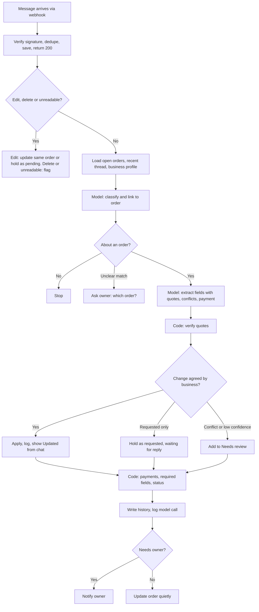

# Pakka — AI PRD

An AI PRD for Pakka, an AI order copilot for small businesses that sell through WhatsApp

## PRD Details

| | |
| --- | --- |
| **Product name** | Pakka |
| **Author** | Pooja Esakkimuthu, AI PM (Codebasics AI PM Bootcamp, BYOP capstone) |
| **Date** | 14 October 2026 |
| **Version** | V1.1 |
| **Status** | Draft for capstone submission |

> **Pain Point:** Small businesses that take custom orders on WhatsApp negotiate and change each order across days of texts, images and payment screenshots, but the current agreed version of the order is never written down anywhere. Owners rely on memory, notebooks and scrolling, so details get missed as order volume grows or when more than one person replies, causing remakes, refunds and lost customers.

## 1. Executive Summary

| | |
| --- | --- |
| **What are we building?** | A companion app that connects to a business's WhatsApp Business number and turns order conversations into live, trustworthy order tickets. Every detail links to its source message, changes are recorded in a history, and anything missing, conflicting or unverified is flagged. Pakka never replies to customers. |
| **Why does it matter?** | WhatsApp is the storefront for millions of small Indian businesses, and custom orders are its messiest workflow. One missed detail ruins an occasion and loses a customer. Meta's Coexistence feature, now supported in India, lets a business keep using the WhatsApp Business app while an approved partner reads the same chats through the API. Pakka can therefore work in the background without changing how owners sell. |
| **Who is it for?** | Primary: owner-operators of small custom-order businesses on WhatsApp Business, working alone or with one or two helpers. Secondary: helpers who reply from the same number. Beachhead segment: home bakers, followed by saree sellers, jewellery makers and cloud kitchens' direct WhatsApp orders. |
| **How will we know it worked?** | North Star: at least 98% of orders delivered with zero detail errors, owner-reported at delivery in the closed beta. |
| **Target launch** | Capstone prototype: October 2026. Closed beta with home bakers: Q1 2027, subject to Meta Tech Provider approval or a provider partnership. |

## 2. Problem Statement and Background

The owner, or a helper replying from the same business number, manages each order by hand:

- Reads and replies to customer messages across days, including text, reference images, voice notes and payment screenshots.
- Copies the order into a notebook, spreadsheet or the phone's notes app at booking.
- Scrolls back through the chat to rebuild the latest version of the order before making it.
- Checks each payment screenshot against the bank or UPI app.

Evidence: conversations with [N] small business owners who sell through WhatsApp. They run the business on a dedicated WhatsApp Business number, often on a phone and a tablet. They move Instagram enquiries to WhatsApp, and they track orders in a notebook, a workbook or the phone's notes app.

### 2.1 Current State

**Trigger:** a customer messages the business on WhatsApp, often after finding it on Instagram.

- **Step 1: Enquiry.** The customer shares the occasion, date and a rough idea; the owner asks follow-up questions.
- **Step 2: Requirements.** Size, flavour or material, design, personalisation text and references arrive in fragments, often with images.
- **Step 3: Price and confirmation.** The owner quotes, the customer negotiates, and they settle. The owner asks for an advance and the customer sends a screenshot.
- **Step 4: Changes.** Days later, the customer changes a detail. The owner or a helper agrees in chat. The notebook entry is often not updated.
- **Step 5: Fulfilment.** Before making and delivering the order, the owner scrolls back to reconstruct what was finally agreed, then coordinates time, address and the balance payment.

### 2.2 Pain Points

- **Details are scattered.** One order spans many messages, formats and days.
- **Changes silently override earlier details.** The latest agreed value isn't obvious, and copied notes go stale.
- **Knowledge is split across people.** A helper agrees to something the owner never sees.
- **Payment checks are manual and risky.** Screenshots must be matched against the bank app, and fake screenshots are a known scam.
- **Volume has a ceiling.** Beyond a handful of open orders, memory and notebooks stop working, so owners cap growth or accept errors.

### 2.3 Business Impact and Why Now

**Cost of the status quo:**

- **Direct cost:** a missed detail can mean remaking the product, refunding the customer, or both. For celebration orders the occasion can't be repeated, so the customer is often lost.
- **Reputation:** these businesses grow through referrals and Instagram, so one bad experience spreads.
- **Time:** owners spend time every day re-reading chats and re-copying notes, time taken from making products.
- **Growth ceiling:** owners can't take more orders without more mistakes or more staff.

**Why now:**

- **Coexistence.** Meta now lets a WhatsApp Business app number connect to the Cloud API without the owner changing how she works, and India is supported. Before this, reading app chats meant asking owners to abandon the app.
- **Multimodal AI.** Current models read mixed-language text, describe images and read payment screenshots reliably and cheaply enough for a small-business price point.
- **WhatsApp is already the storefront.** Owners and customers are there; Pakka adds no new channel.

### 2.4 Job To Be Done Framing

| | |
| --- | --- |
| **Job to be done** | **When** I'm handling several custom orders over WhatsApp, each changing over days, **help me** always know the current, agreed version of every order and what needs my review, **so that I can** deliver every order exactly right without re-reading chats or keeping separate notes. |
| **Trigger** | A new order enquiry, any change to an open order, or preparing to make or deliver an order. |
| **Outcome** | The owner knows any order's current state in under a minute, with zero re-copying, and every delivered order matches what was agreed. |
| **Why AI is justified** | The input is unstructured, multimodal and mixed-language, and agreement is spread across a conversation, so rules and forms can't capture it, and customers won't fill in forms. Working out which order a message refers to, whether it changes something, and whether it was agreed needs language understanding. Deterministic code handles everything that needs no judgment: totals, required-field checks and status rules. |

## 3. Opportunity and AI Capability Mapping

| Opportunity | AI capability used |
| --- | --- |
| Decide whether a message is about an order, which order, and what kind (new detail, change, agreement, payment, small talk) | **Classification** |
| Pull order details into a structured ticket, each with the exact supporting words from the chat | **Information extraction (structured output)** |
| Detect changes, conflicts and agreement across the conversation | **Contextual reasoning over conversation history** |
| Describe reference images and read amounts and references from payment screenshots | **Vision (image understanding and OCR)** |
| Check required fields, compute balances, set statuses, verify quotes appear in source messages | **Deterministic rules (intentionally not AI)** |

## 4. Personas and User Stories

### 4.1 User Personas

| Persona | Description |
| --- | --- |
| **Primary: Kavya, solo home baker** | Runs a custom celebration cake business alone on a dedicated WhatsApp Business number; Instagram for discovery. **Goal:** deliver every order exactly as agreed and spend her time baking. **Frustration:** scrolling back to rebuild orders; changes that override earlier details; checking payment screenshots by hand. |
| **Primary: Ayesha, home bakery owner with two helpers** | Takes 20 to 30 custom orders a week; she and two helpers reply from one business number on a phone and a tablet. **Goal:** grow without losing control. **Frustration:** helpers agree to things she never sees; a shared notebook that's always out of date. |
| **Secondary: Divya, part-time helper** | Replies to customers while the owner is busy. **Goal:** answer confidently without contradicting earlier agreements. **Frustration:** no quick way to see an order's history before replying. |

### 4.2 User Stories

| As a... | I want to... | So that... | Acceptance criteria |
| --- | --- | --- | --- |
| **Owner** | see all open orders by due date, with what needs review first | I can plan my week at a glance | Given open orders exist, when I open Pakka, then I see them in week groups, each with a date block, a bold time, a status pill and a one-line summary of open issues, plus counts of open, needs-review and due-this-week orders |
| **Owner** | have details from the chat appear on the order automatically | I never re-copy anything | Given a customer states a detail and the business agrees, when the message syncs, then the field updates on the right order within 10 seconds, with a link to its source |
| **Owner** | see where any detail came from | I can trust the ticket | Given a field on a ticket, when I tap its source link, then I see the exact messages it came from, with the supporting words highlighted |
| **Owner** | know when something changed, without approving it again | I stay informed without double work | Given a change the business agreed in chat, when it syncs, then it applies automatically, shows "Updated from chat" with the previous value, and is logged in History, with no action required |
| **Owner** | see requests the business hasn't agreed to yet | I don't miss what a customer is waiting on | Given a customer requests a change and the business hasn't replied, when it syncs, then the current value stays and the ticket shows "Requested: [value], waiting for your reply" |
| **Owner** | be warned about payment screenshots that don't match | I don't lose money to errors or fakes | Given a screenshot amount differs from the advance requested, when it syncs, then the ticket shows "Payment screenshot doesn't match" and never shows the order as paid |
| **Owner** | confirm an order only when its required details are in | I never make something from an incomplete order | Given a required field is missing, when I view the ticket, then Confirm is disabled and the missing detail is named |
| **Owner** | be asked to choose when Pakka isn't sure | details never land on the wrong order or the wrong price | Given a customer has two open orders and the match is unclear, or two incompatible values appear, when the message syncs, then I see "Which order is this about?" or both values to choose from, and nothing is applied until I choose |
| **Owner** | correct any detail myself | the ticket is always right even when the AI is wrong | Given any field, when I edit it, then it saves and is marked "Edited by you" in the ticket and History |
| **Helper** | see an order's current state before replying | I don't contradict what was already agreed | Given I open a ticket, when it loads, then I see current values, recent updates and open issues, with no extra account needed |

## 5. Model Strategy

Choosing the underlying model and build approach is an engineering decision, made jointly with the product team rather than by the product team alone.

**What product owns:**

- **Context requirements:** which inputs the model sees per message and which it never sees (section 7).
- **Approval gates:** the AI can update draft information, but only the owner can confirm an order, mark a payment as received, or resolve a conflict. The AI never messages customers.
- **Audit logging:** every model call is logged with the model, input and output tokens and latency. Every field keeps its source message, and every change is recorded in the order history.
- **Human-in-the-loop controls:** low-confidence extractions, unclear order matches and conflicts are routed to the owner and never resolved automatically. The owner can edit any field, and edits are marked "Edited by you".

**Initial approach** (agreed with engineering for the prototype):

- **Model:** the prototype uses Gemini 3.5 Flash-Lite on the free tier with synthetic data only, one call per message and structured JSON output, with the model's thinking set to the lowest level it allows. All model calls sit behind a provider-agnostic adapter, so the model is a configuration change.
- **Production:** a paid API tier whose terms exclude training on customer data. Gemini Flash and Claude Sonnet will be compared on the eval set for accuracy, latency and cost.
- **Retrieval:** no fine-tuning and no RAG. The context per message (recent thread, open orders, business profile) is small enough to pass directly.
- **Configurability:** behaviour is controlled by a versioned system prompt plus the business profile, where each field has a plain-language description that tells the model what belongs in it.

## 6. Functional Requirements

| ID | Requirement | Priority | Status |
| --- | --- | --- | --- |
| **FR-1** | Receive customer messages and business replies in real time, including text, images, edits, deletions and unreadable messages | Must | In progress |
| **FR-2** | Classify each message and link it to an existing order, a new order, or no order | Must | In progress |
| **FR-3** | Extract the order fields defined by the business profile, each with the exact supporting quote; drop any extraction whose quote isn't found in the message | Must | In progress |
| **FR-4** | Apply changes agreed in chat automatically, show "Updated from chat", keep the previous value, and log the change | Must | In progress |
| **FR-5** | Hold customer requests the business hasn't agreed to as "Requested, waiting for your reply", without changing the current value | Must | In progress |
| **FR-6** | Raise "Needs review" items for: missing required fields, conflicts, payment mismatches, low-confidence extractions, unclear order matches, and deleted or unreadable messages | Must | In progress |
| **FR-7** | Read payment screenshots (amount, reference, payee, date); never treat them as proof of payment; compute balances in code | Must | In progress |
| **FR-8** | Attach reference images to the relevant order with a short description | Must | In progress |
| **FR-9** | Show the exact source messages behind any field | Must | In progress |
| **FR-10** | Allow confirmation only when all required fields are present; keep a confirmed order confirmed after an agreed change, marked "Updated after confirmation" until viewed | Must | In progress |
| **FR-11** | Let the owner edit any field (marked "Edited by you"), mark payments as received, resolve issues, and mark orders delivered or cancelled | Must | In progress |
| **FR-12** | Support business profiles that define fields, descriptions, field types and required fields; ship bakery (demo) and saree profiles | Should | In progress |
| **FR-13** | Open the customer's WhatsApp chat from any order | Should | In progress |
| **FR-14** | Notify the owner only when an order needs review, never for every message | Should | Mocked in prototype (in-app toast) |
| **FR-15** | Show sync status, and a "Sync paused" banner when the WhatsApp connection drops | Should | In progress |
| **FR-16** | Transcribe voice notes into the same pipeline | Could | Deferred |
| **FR-17** | Apply a customer's edit to the order the original message created; never create a second order from an edit | Must | In progress |
| **FR-18** | Show a read-only list of customer chats, with a link to reply in WhatsApp | Should | In progress |

## 7. Context and Data Pipeline

Context is the product. What goes in, and what stays out, defines what the AI can and cannot do.

### 7.1 What Goes In

| Input | Source and notes |
| --- | --- |
| **New message** | WhatsApp webhook: text, image (with caption), edit or deletion event. Sender role marked "customer" or "business" |
| **Recent conversation** | The last 15 messages in this customer's chat, with message IDs and sender roles, so the model can judge agreement and changes |
| **Customer's open orders** | Current field values, IDs and open pending requests for that customer's open orders only |
| **Business profile** | Field keys, labels, types and plain-language descriptions for the business type |
| **Time context** | The message's date, weekday and timestamp, so relative dates ("this Saturday", "kal") can be resolved |

### 7.2 Deliberately Excluded From Context

Every attribute excluded here is an attribute the AI cannot act on, intentionally or not. This is the first line of bias defence.

| Excluded attribute | Reason for exclusion |
| --- | --- |
| **Customer phone numbers and full contact names** | Replaced with internal IDs; not needed to understand an order (data minimisation) |
| **Other customers' chats and orders** | Prevents cross-customer leakage and wrong-order links |
| **Customer history beyond current open orders** (past spend, frequency, location patterns) | The model treats every customer's order the same way; no profiling or prioritising by customer value |
| **Group chats and personal chats** | Not order channels; group chats aren't synced by WhatsApp's API |
| **Bank or UPI account data** | Pakka never accesses financial accounts; payment verification stays with the owner |

### 7.3 Business Profiles

Pakka is generic across custom-order businesses through business profiles. Every profile shares universal fields and adds its own. Each field has a key, label, type, plain-language description and required flag.

| Type | Fields |
| --- | --- |
| **Universal** | Occasion, items, due date, due time, fulfilment (pickup, delivery or courier), address, tracking number (courier), price agreed, advance requested (as stated by the business), balance (calculated by the app), reference images |
| **Bakery (demo)** | Size or weight, flavour, dietary, design notes, message on cake (exact text) |
| **Saree** | Fabric, colour, quantity, blouse stitching measurements, fall and pico, embroidery (exact text) |
| **Jewellery (coming soon)** | Metal, purity, weight, ring or bangle size, design reference, engraving (exact text) |
| **Food orders on WhatsApp (coming soon)** | Dishes and quantities, guests, spice level, veg or non-veg, packaging notes. Orders from Swiggy, Zomato and similar apps are excluded |

**Field types:** exact text (spelling preserved, never corrected), measurement (always shown with its source), money (copied as stated, never calculated by the model), date, time, enum, items list.

## 8. Non-Functional Requirements

| Category | Requirement and target |
| --- | --- |
| **Performance** | Ticket updated within 10 seconds of a message arriving (p95). The webhook is acknowledged within 2 seconds, with AI processing in the background. The prototype's model calls average about 2 to 5 seconds |
| **Reliability / uptime** | 99.5% availability in beta. No message lost: deduplicated by WhatsApp message ID, failed processing retried with backoff, and failures shown to the owner rather than silently skipped |
| **Security** | Webhook signatures verified. Access tokens stored server-side only. Encryption in transit and at rest. Owner login required. Demo pages protected by a passcode |
| **Privacy and compliance** | Designed for India's DPDP Act: the business is the data fiduciary and Pakka the data processor (to be confirmed by legal review). Explicit owner consent at onboarding, chat-history sharing opt-in, only order-relevant data stored, a defined retention period, deletion on disconnect. The prototype uses synthetic data only. Production must use a paid API tier whose terms exclude training on customer data |
| **Scalability** | One business handles 300+ messages a day without degraded latency. The architecture supports thousands of businesses on shared infrastructure |
| **Usability** | Mobile-first and installable as a web app. Body text at least 14 pt. Status never shown by colour alone. Works on phone, tablet and laptop |
| **Integrations** | WhatsApp Cloud API with Coexistence (production); Cloud API test number and a simulator (prototype); Gemini API; Supabase |

## 9. Behaviour, Output Specification and Workflow

This section specifies the behaviour, not just the output: what the AI does in every state, including when it is uncertain or wrong.

**Key screens** (designs: [Figma link]):

- **Orders:** week groups with date blocks and bold times, with "Needs review" shown first.
- **Order:** updates, issues, details with source links, payments and history.
- **Source sheet:** the exact messages behind any field.
- **Chats:** a read-only list of customers.
- **Your business:** the business profile and the details Pakka tracks.
- **Edge states:** sync paused, waiting for reply, conflict, which order, unreadable message.

### 9.1 Standard Output Per Order

| Output field | Description |
| --- | --- |
| **Order fields** | Each profile field with its value, source message link, confidence, and the previous value if changed |
| **Status** | Needs review, Ready to confirm, Confirmed, Delivered, Cancelled |
| **Needs review items** | Issues requiring the owner, each with a plain-language explanation and a direct action |
| **Updates from chat** | Informational notes about agreed changes, dismissed with "Got it" |
| **Payments** | Price agreed, advance requested, screenshot amounts (unverified until the owner marks them received), and the balance calculated in code |
| **History** | A timestamped log of every change, its source, and who made it (chat or owner) |

### 9.2 Required Behaviour States

| State | What triggers it | Required behaviour |
| --- | --- | --- |
| **Updated from chat** | The customer requests a change and the business agrees in chat | Apply the change, show the previous value, log it, show an informational note. No action required |
| **Requested, waiting for reply** | The customer requests a change and the business hasn't replied | Keep the current value; show the requested value with "Reply in WhatsApp" |
| **Low confidence** | The model is unsure of a value, or a quote fails verification | Apply or hold as appropriate, and add "Check this" under Needs review, with the source |
| **Conflict** | Two incompatible values with no clear change (e.g. two prices) | Pick neither; show both under Needs review for the owner to choose |
| **Unclear order match** | The customer has multiple open orders and the message is ambiguous | Ask "Which order is this about?" and apply nothing until the owner chooses |
| **Payment received (unverified)** | A payment screenshot arrives | Record the amount and reference; mark it unverified; flag a mismatch if it differs from the advance requested; never show "paid" |
| **Updated after confirmation** | An agreed change arrives on a confirmed order | Keep it confirmed, apply the change, and mark "Updated after confirmation" until viewed |
| **Edited message** | The customer edits an earlier message | If the business hasn't replied since the original, apply the new values to the same order and add a "Customer edited a message" note. If it has replied, treat each changed value as a pending request. Never create a second order from an edit |
| **Deleted message** | A deletion event | Flag the affected fields as needing a check |
| **Unreadable message** | Unsupported message event (error 131060) | Flag "1 message couldn't be read; check WhatsApp" |
| **Sync paused** | WhatsApp disconnection event | Show a persistent banner on every screen until reconnected; never show stale data as current |

### 9.3 End-to-End Decision Flow

- Step 1: A message arrives through the webhook (or the simulator); the signature is verified.
- Step 2: The message is deduplicated, saved, and acknowledged immediately.
- Step 3: Edits, deletions and unreadable messages branch to their own handling (9.2). An edit updates the order the original message created.
- Step 4: The system loads the customer's open orders, open pending requests, the last 15 messages and the business profile.
- Step 5: The model classifies the message and links it to an order, a new order, or none.
- Step 6: If the message isn't about an order, stop.
- Step 7: If the order match is unclear, raise "Which order is this about?" and wait for the owner.
- Step 8: The model extracts field updates with supporting quotes, plus any conflicts, agreements, image role and payment details.
- Step 9: Code verifies each quote appears in the message; failures become low-confidence items.
- Step 10: Code compares values with the current ticket. Changes agreed by the business apply as updates; unagreed requests are held as pending; conflicts go to Needs review.
- Step 11: For payment screenshots, code records the amount, recalculates the balance, and flags any mismatch.
- Step 12: Code rechecks required fields and recomputes the status.
- Step 13: The order history is written and the model call logged.
- Step 14: If anything now needs review, the owner is notified; the ticket updates on screen.

### 9.4 Flow Diagram

### 9.5 Copy Guidelines

- **Name agreements honestly.** Say "Agreed in chat by your business", not "You agreed", because WhatsApp doesn't identify which team member replied.
- **Never say "paid".** Use "Screenshot received · not verified" until the owner marks a payment as received.
- **Status labels:** Confirmed, Ready to confirm, Updated from chat, Needs review.
- **Describe issues plainly** and pair each with a direct action, for example "Address missing. Add address."
- **Label calculated numbers** with "Calculated by the app, not read from chat."

## 10. Guardrails and Failure Modes

Each failure mode has a required guardrail. In this domain, an order made from a wrong detail and false payment confidence are the highest-risk failure modes.

| Failure mode | What goes wrong | Required guardrail | Owner |
| --- | --- | --- | --- |
| **Hallucinated detail** | The AI fills a field the chat never stated | Every extraction must include a quote verified in code; unsupported fields stay blank and are flagged | Engineering |
| **Wrong order link** | A detail lands on the customer's other order | Ambiguous matches go to the owner; links are shown on the ticket with sources | Product + Engineering |
| **Misread change** | An old value is kept or a new one misapplied | Changes show the previous value and source; unagreed requests are held as pending; low-confidence changes go to Needs review | Engineering |
| **Edit creates a duplicate order** | An edited message is read as a new order | Edits update the originating order; a duplicate-order check runs in every eval | Engineering |
| **False payment confidence** | A fake or wrong screenshot is treated as payment | Payments stay unverified until the owner marks them received; mismatches are flagged; "paid" is never shown | Product |
| **Run-to-run variance** | The model sometimes leaves a required field empty or reads two similar fields differently | A missing-field flag the owner can fill in; clear field descriptions in each profile; every scenario repeated three times in evals and reported as a pass rate | Engineering |
| **Silent sync failure** | The owner trusts a ticket that stopped updating | Sync status always visible; "Sync paused" banner; unreadable messages flagged | Engineering |
| **Over-reliance** | The owner stops checking and the AI is wrong | Confirm is a human action; required fields block it; every field links to its source; the in-app note says the ticket is built from synced messages | Product |
| **Privacy breach** | Customer data exposed or misused | Minimal context, no cross-customer data, encryption, retention limits, deletion on disconnect, DPDP review | Product + Legal |
| **AI acting on customers** | The product sends messages or makes promises | Pakka has no capability to send customer messages | Product |

## 11. Eval Criteria

Eval criteria define whether the AI is ready to launch. This is different from success metrics, which measure business outcomes after launch.

**Eval set:** seven scripted scenarios (a clean order, an agreed change, an edited message, two orders from one customer, a price conflict, a payment mismatch, and small talk) plus about 60 additional synthetic messages covering Hinglish, typos, relative dates, multiple open orders, edits, deletions and images. All are documented in the README. Each scenario is run three times and reported as a pass rate, because model output varies between runs.

| Eval dimension | Definition and threshold |
| --- | --- |
| **Hallucinated fields** | Fields with a value not supported by the chat: **0** in the eval set (launch blocker) |
| **Required fields filled** | Orders where every required field the chat states is filled: **at least 95%** of runs |
| **Field extraction accuracy** | Correct value in the correct field: **at least 95%** |
| **Exact text preservation** | Personalisation text copied exactly, including spelling: **100%** |
| **Order linking accuracy** | Messages linked to the correct order, with ambiguous cases routed to the owner rather than guessed: **at least 95%** |
| **Change and agreement detection** | Changes correctly classified as agreed, requested-only or conflict: **at least 95%** |
| **Edit handling** | An edited message updates the existing order and never creates a duplicate: **100%** |
| **Payment reading** | Amounts read correctly from screenshots: **at least 98%**, and **0** cases of an order shown as paid |
| **Small talk false updates** | Non-order messages that change a ticket: **2% or less** |
| **Language parity** | Accuracy on Hinglish and mixed-language messages within **5 points** of English |
| **Latency** | Ticket updated within **10 seconds** (p95) |

**Prototype results:** [scenarios passed, pass rate over three runs, average latency and cost per order, from docs/EVAL_RESULTS.md].

## 12. Success Metrics

| Layer | Metric | Target / threshold |
| --- | --- | --- |
| **North Star** | Orders delivered with zero detail errors (owner-reported at delivery) | At least 98% in closed beta |
| **Output (shallow)** | Orders with a complete ticket at least 24 hours before due | At least 90% |
| **Trust signal (AI-specific)** | Fields kept without owner edits | At least 90% |
| **Guardrail metric (AI-specific)** | Owner-reported wrong details caused by Pakka | Fewer than 1 per 100 orders |
| **User experience (AI-specific)** | Time to know an order's current state; active days per week per owner | Under 1 minute; at least 4 |
| **Effort** | Owners who stop keeping a separate notebook or notes app (survey) | At least 70% after 4 weeks |
| **Cost (AI-specific)** | AI and hosting cost per active business per month | About ₹250 or less at 100 orders a month; today's estimate is about ₹175 to ₹220, depending on the exchange rate |

## 13. Scope and MVP Boundary

### 13.1 Out of Scope (Permanently)

| Out of scope item | Reason / when it may be revisited |
| --- | --- |
| **Sending messages to customers** | Pakka is a copilot, not an agent; the customer relationship stays with the owner. Not revisited |
| **Verifying payments against bank accounts** | Requires financial access and regulation; verification stays with the owner. Not revisited |
| **Aggregator orders (Swiggy, Zomato and similar)** | Those orders already arrive structured on the platforms; Pakka covers orders taken directly on WhatsApp. Not revisited |
| **Group chats** | Not synced by WhatsApp's API, and not an order channel for the target users |

### 13.2 V1 Ships vs Later, Deferred

| V1 ships | Later, explicitly deferred |
| --- | --- |
| Live order tickets from WhatsApp chats; source links and history; Needs review issues and "Updated from chat" notes; payment screenshot reading with mismatch flags; edit handling; chats view; bakery profile, plus a saree profile to show extensibility | Voice note transcription; Instagram messages; individual helper accounts and roles; regional-language interface (for example Tamil and Hindi); real push notifications (an in-app toast in the prototype); jewellery and food-order profiles; live WhatsApp webhook (the prototype runs on a simulator) |

## 14. Rollout and Release Strategy

An AI feature earns trust incrementally. Each stage below has a gate condition before moving forward.

| Stage | Definition and gate condition |
| --- | --- |
| **Stage 1: Alpha (capstone prototype)** | Simulator with synthetic data, plus a Cloud API test number if time allows. **Gate:** all eval thresholds in section 11 met on the eval set |
| **Stage 2: Closed beta** | 10 to 20 home bakers through Tech Provider approval or a provider partnership, with weekly feedback calls. **Gate:** zero hallucinated-detail incidents reaching a delivered order; at least 90% of fields kept without edits; North Star at least 95% |
| **Stage 3: Phased rollout by segment** | Open to all home bakers, then saree and jewellery sellers, then cloud kitchens' direct WhatsApp orders, each with its own profile evals. **Gate:** each new profile meets section 11 thresholds before release |
| **Stage 4: Full release** | Public self-serve onboarding. **Gate:** North Star at least 98% across segments; support load sustainable |

### 14.1 Kill Switch Conditions

Pause AI updates and fall back to read-only chat sync if any of the following occur:

- Any confirmed case of a hallucinated detail causing a wrong delivered order, until root-caused.
- Any case of an order shown as paid without the owner marking it received.
- Cross-customer data appearing on the wrong business's or customer's ticket.
- Wrong-order links above 3% in a rolling week.

## 15. Timeline and Milestones

| Milestone | Target date | Owner / notes |
| --- | --- | --- |
| **Synopsis approved** | Done | Pooja |
| **Discovery worksheet and opportunity map** | October 2026 (done) | Pooja |
| **PRD and cost estimate** | October 2026 | Pooja |
| **Prototype deployed (simulator; live mode if time allows)** | October 2026, capstone deadline | Pooja, using Claude Code |
| **Presentation and demo video** | October 2026, capstone deadline | Pooja |
| **Closed beta** | Q1 2027 | Depends on the Tech Provider route (section 16) |

## 16. Open Questions and Assumptions Log

| Open question / assumption | Ticket type | Owner | How we resolve it |
| --- | --- | --- | --- |
| **Become a Meta Tech Provider, or partner with an existing provider for Coexistence onboarding?** | Spike | Product + Engineering | Compare timelines, cost and control; decide before beta |
| **How many owners reply from WhatsApp for Windows (an unsupported device)?** | Research | Product | Ask beta owners; if common, add onboarding guidance to use supported devices |
| **Assumption: owners will pay a small monthly fee, and ₹499 leaves little margin if usage triples** | Research | Product | Willingness-to-pay interviews in beta; test ₹799 and a fair-use limit on images |
| **Currency risk: model costs are in dollars, revenue in rupees** | Research | Product | Review pricing as the exchange rate moves |
| **Variance on lite models: required fields sometimes left empty** | Eval | Engineering | Repeat each scenario three times; compare against a full Flash model when traffic is lower; switch only if the pass rate drops |
| **Accuracy on Tamil, Hindi and other regional-language messages** | Eval | Engineering | Extend the eval set before expanding beyond Hinglish |
| **DPDP roles and consent for customers' data** | Legal review | Product + Legal | Confirm the processor role, consent wording and retention period before beta |
| **Deleted or unreadable messages attach to the most recently updated open order, which may be the wrong one** | Design | Product + Engineering | Attach them to the customer's chat and show them on that customer's open orders |
| **How do owners prefer to mark orders delivered?** | Design | Product | Test a manual tap against detection from chat in beta |